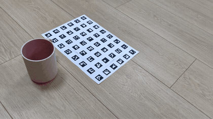
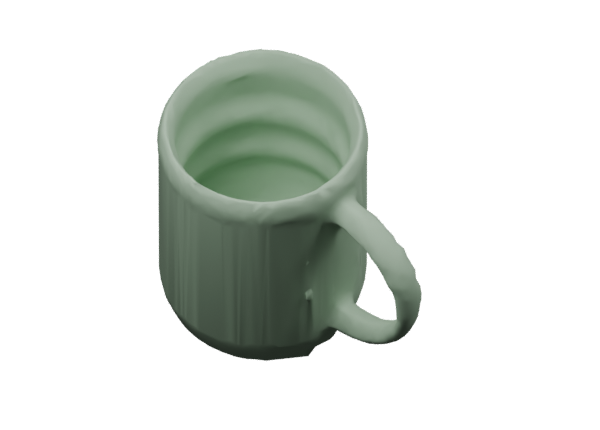

# packing-assets

**手机视频 → 同尺度、低面数 OBJ / PyBullet 仿真资产。**

每个视频对应一件物品；旁放一张固定 A4 参照板，程序自动抽帧、恢复相机、按实际尺度重建、分割、检查几何并批量导出。默认流程在本地运行，不需要 API key。

[中文使用指南](docs/guide.zh-CN.md) · [English](docs/README.en.md) · [拍摄与打印](docs/capture.zh-CN.md) · [算法与限制](docs/quality.md) · [开发说明](docs/development.md)

**手机网页上传**：运行 `./run-upload.sh`，手机连接同一热点／Wi-Fi，打开终端打印的地址并输入配对码，即可录制或选择视频，分块续传到电脑、逐件自动生成、下载 OBJ。默认 Meshy 本地尺寸混合路线、不生成 smooth；上传页明确提示 API 积分消耗，也可选择 local。详见 [局域网上传说明](docs/phone-upload.md)。

可选 **[Meshy 分支](docs/meshy.md)**：`./run-videos.sh input output_me --backend meshy --key-file /path/to/meshy-key.txt`。默认共用 A4 相机与深度缓存测量本地尺寸，再约束 Meshy 外形；通过检查会额外导出 `_dimensions.obj`，原 OBJ 保留，不做平滑。可加 `--meshy-frontend fast` 选择快速照片校正、`--meshy-frontend full` 选择旧完整路线、`--with-smooth` 恢复平滑版本。会上传物体图片并产生 API 费用；已有同视频的完整路线生成通过内容指纹校验后可复用，不重复扣费。杯碗内腔继续使用本地分支。

Meshy 已生成但形状检查未通过的闭合模型也保留普通／平滑 OBJ，标为 `retained_unvalidated`，原检查结果见各模型 `status.json`。尺寸校准或闭合性检查失败时保留原始 GLB／OBJ 备用，原始文件未定标，不应直接按米使用。

也可先执行 `.venv/bin/packing-assets configure-meshy --key-file /path/to/meshy-key.txt` 保存本机路径，以后省略 `--key-file`。缺少或无法读取凭据时，在开始重建前报错；已下载缓存可离线导出。

> 实验性重建工具。输出水密不代表尺寸和细节精确。弱纹理、反光、透明、细薄结构和隐藏内腔仍可能失败；失败项目会明确报告，成功候选也需要检查。

## 视频到模型演示

<table>
<tr><th>输入：手机绕拍 + A4 参照板</th><th>输出：米制 OBJ（本地平滑版）</th></tr>
<tr><td></td><td></td></tr>
</table>

真实马克杯视频案例，左侧为原视频片段的 **4 倍速、无声 GIF**，右侧为同一物体的本地重建平滑结果，不是 Meshy 生成或人工建模。模型保留内腔，包围盒约 **116.2 × 85.3 × 105.6 mm**；尺寸来自 A4 定标，未经实测精度认证。此案例包含杯类几何修复与平滑，不能代表任意物体的原始重建效果。

[下载示例 OBJ](examples/mug/mug.obj) · [案例说明与验证数据](examples/mug/README.md)。GIF 仅用于展示，重建请使用原始视频。

## 选择流程

| 路线 | 用途 | 费用与限制 |
|---|---|---|
| 本地重建（CLI 默认） | 视频几何与尺度恢复；杯碗内腔 | 不调用付费 API；需要 NVIDIA GPU，反光/弱纹理可能失败 |
| Meshy + 本地尺寸（网页默认） | 生成外形，再用本地测量约束尺寸 | Meshy API 消耗积分；复用缓存，不保证隐藏结构正确 |
| Meshy 快速照片校正 | 减少本地计算，优先快速获得候选 | `--meshy-frontend fast`；尺寸和外形更需要核验 |

Blender 只用于展示，PyBullet 只用于可选仿真检查，均不是 OBJ 重建的必需项。Hunyuan 分支仍是实验性工具，暂未接入稳定批处理。

## 快速开始

本机生成模型的试验见 [Hunyuan3D-2mv](docs/hunyuan.md)：已实测瓶子、键盘和飞机，包含离线安装／运行入口、显存与时间记录，以及未通过质量检查的具体原因。

支持的完整重建环境：**Linux + NVIDIA GPU/CUDA 12 兼容驱动 + Python 3.10+**。导出 OBJ 不需要 Blender 或 PyBullet。主要验证环境为 Python 3.12、RTX 5080；尚未验证 Windows/macOS 的完整重建。CPU 可运行部分单元测试，不能替代 GPU 深度重建。

```bash
# 在仓库根目录运行；需先安装 Python venv、git、curl
./scripts/setup_all.sh

# 一件物品一个视频，文件名即模型名
mkdir -p input
# 将 keyboard.mp4、bottle.mp4 等放入 input/
./run-videos.sh input output_me

# 指定一件或多件；不写 --objects 默认全部
./run-videos.sh input output_me --objects keyboard
./run-videos.sh input output_me --objects keyboard.mp4 bottle.mp4
```

指定物体时共享原重建缓存，交付与报告单独写入 `output_me/selected/<选择ID>/`，保留原全量结果；终端会打印实际输出路径。支持完整文件名或无歧义的物体名，可与 Meshy、Blender、碰撞等选项组合。

打印 [A4 参照板 PDF](calibration/a4-dense/reference-board.pdf)，选择 **100% / 实际大小**，量一次校验线；把纸和物品放在同一平面并保持固定。手机用 1080p 视频缓慢绕拍，建议加入低、中、高角度；杯碗必须拍到内壁和内底。详见[拍摄指南](docs/capture.zh-CN.md)。

程序按物体连续完成重建、可选 Meshy、降面／平滑和检查，**每完成一件立即写入 `models/物体名/`**，不等待整个文件夹重建结束。已完成模型可直接查看；后续物体失败或中断不会删掉它们。汇总场景、可选仿真和 ZIP 在整批末尾生成。

进度会显示当前物品、阶段、缓存复用、实际帧计数及已用时间：

```text
逐件生成与导出 [######--------------] 1/3 | 2/3 keyboard.mp4 | 分割物体 24/48 帧 | 本步 12s / 总计 170s
逐件生成与导出 [#############-------] 2/3 | 3/3 bottle.mp4 | 降面、平滑和水密检查
```

主流程进度条是**已完成导出或已明确失败的物品数量**，不是仅重建完成数量，也不是剩余时间预测；成功数量单列在报告的 `exported` 中。深度重建等不提供细粒度进度的库调用显示阶段和计时，算法输出写入 `run.log`；`progress.json` 持续更新，便于接入自己的界面。

## 输出

```text
output_me/
  models/
    keyboard/
      keyboard.obj           # 最终低面数、米制、Z 向上
      keyboard_smooth.obj    # 平滑外观版
      status.json            # 尺寸、状态、最终文件水密检查
    index.json
  scene.json                 # 同尺度布局数据，无需 Blender
  scene.blend                # 仅 --with-blender 时生成
  scene-smooth.blend          # 仅 --with-blender 时生成
  scene-package.zip          # 模型、场景与运行报告
  run-report.json
  progress.json
  run.log
  reconstruction/            # 诊断缓存，可能包含不封闭的原始表面
```

**请使用 `models/` 中的最终文件。** `reconstruction/.../visual.obj` 是原始测量表面，可能有开边、没有底面，不能当作最终水密模型。

## 其他入口

默认安装只包含重建和 OBJ 导出。以下功能独立选配，不影响默认几何质量检查：

| 功能 | 安装 | 运行选项 |
|---|---|---|
| Blender 展示／独立导入验证 | 自行安装外部 Blender | `--with-blender` |
| 碰撞块与 URDF | `.venv/bin/pip install -e '.[collision]'` | `--with-collision` |
| PyBullet 仿真检查 | `.venv/bin/pip install -e '.[pybullet]'` | `--pybullet`（含碰撞导出） |

```bash
# 安装 Blender 后，额外生成普通和平滑展示场景
./run-videos.sh input output_me --with-blender

# 可选碰撞/仿真包：先装依赖，再复用重建
.venv/bin/pip install -e '.[pybullet]'
./run-videos.sh input output_me --pybullet
# 旧入口 ./run-a4-fast.sh input output_me 等价于启用 PyBullet

# 较慢的高分辨率重建；使用新的输出目录
./run-a4.sh input output_standard

# 默认无 Blender、无 PyBullet，纯文本进度
.venv/bin/packing-assets run --input input --out output_me \
  --board calibration/a4-dense/board.json --quality fast --obj-only \
  --progress plain
```

可使用 [settings 示例](examples/settings.json) 指定杯碗类别及质量；未提供质量时仅用预览默认值。视觉模型通常以 8,000 面为起点，无法满足简化检查时增加面数或报告失败。物理碰撞分解另需时间。

同一命令可以恢复缓存；不要让两个进程写同一输出目录。输入、参照板或重建参数改变时用新输出目录。详细参数、退出码与常见错误见[使用指南](docs/guide.zh-CN.md)。

## 项目结构

- `packing_assets/`：重建、定标、质量检查、导出及 CLI。
- `scripts/`：安装、场景查看、诊断及可复现的合成样例工具。
- `tests/`：单位、几何、缓存、失败隔离和进度显示测试。
- `calibration/`：参照板定义与可打印资源；默认使用 `a4-dense`。
- `docs/`、`examples/`：公开文档与参数示例。

除上述明确选入的演示 GIF、结果图片和示例 OBJ 外，原始视频、实验结果、缓存、模型权重、虚拟环境和旧实验记录不属于源码仓库，均已忽略。下载权重由安装脚本完成；不在仓库中再分发第三方权重。

## 开发与许可证

```bash
.venv/bin/pytest -q                  # 完整已安装环境
.venv/bin/python scripts/package_source.py  # 只打包公开源码
```

[MIT License](LICENSE) 适用于本项目自有代码。第三方依赖保留各自许可证，**并非全部为 MIT**；例如 SAM 2 为 Apache-2.0、`plyfile` 为 GPL-3.0-or-later，Blender 是外部 GPL 工具。见 [THIRD_PARTY_NOTICES](THIRD_PARTY_NOTICES.md)。本项目不声称对第三方依赖重新授权。
