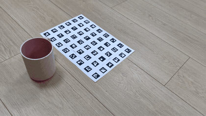
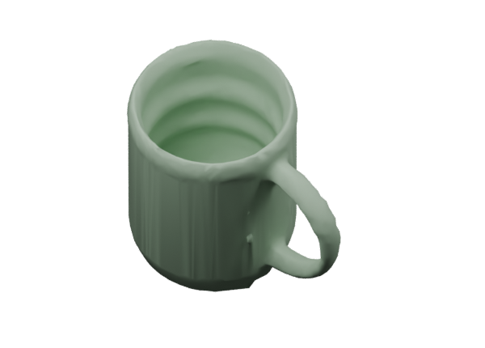

# packing-assets

Turn one phone video per object into metric, low-poly OBJ assets for packing simulation. Place a printed A4 reference beside each object. The local pipeline estimates cameras, reconstructs stereo geometry, segments the object, checks candidate geometry and exports ordinary/smoothed meshes. Optional PyBullet output uses compound convex collisions.

**Experimental:** watertight topology is not proof of shape or dimensional accuracy. Thin, reflective, transparent and unobserved features may fail. See [quality and limitations](quality.md).

An optional paid Meshy branch is integrated: `./run-videos.sh input output_me --backend meshy --key-file /path/to/meshy-key.txt`. Per-object `backend` settings allow mixed local/Meshy batches. The default backend remains local, with no paid calls. Meshy defaults to hybrid local dimension measurement, reusing A4 camera/depth caches to constrain the generated shape. Use `--meshy-frontend fast` for photo-based fitting without proactively building a full local measurement. Use `--meshy-frontend full` for the legacy route. Meshy smoothing is off unless `--with-smooth` is supplied. Existing paid generations can be reused after verifying the original video/board fingerprint. Open-container validation currently requires the local branch. See [Meshy workflow, execution status and benchmark](meshy.md).

## Real video example

| Phone video + A4 reference | Local smoothed reconstruction |
|---|---|
|  |  |

The silent GIF is an excerpt played at 4× speed. The result uses local reconstruction, cup geometry repair and smoothing, not Meshy or a manually modelled replacement. Its estimated bounding box is 116.2 × 85.3 × 105.6 mm; A4-derived dimensions are not independently certified measurements. See the [sample OBJ and validation](../examples/mug/README.md). The GIF is a preview, not reconstruction input.

## Quick start

Full reconstruction currently requires Linux, an NVIDIA GPU with a CUDA 12 compatible driver and Python 3.10+. Blender and PyBullet are optional; the default installer and OBJ workflow do not require either. The main tested environment uses Python 3.12 and an RTX 5080. Windows/macOS end-to-end support is not verified. Use a repository checkout and editable installation; standalone wheel deployment is not supported yet.

```bash
./scripts/setup_all.sh
# Put one original 1080p video per object in input/
./run-videos.sh input output_me
./run-videos.sh input output_me --objects keyboard.mp4 bottle.mp4
```

Omit `--objects` to process all inputs. Selection accepts exact filenames or unambiguous stems, reuses shared reconstruction/Meshy caches and writes delivery/progress/reports under `output_me/selected/<selection-id>/`, preserving the full-batch delivery. The terminal prints the actual output path.

Print [the A4 board](../calibration/a4-dense/reference-board.pdf) at actual size / 100%, check the scale lines once, and keep the board and object stationary on the same flat support. Orbit slowly with overlapping low/mid/high views. Capture cup/bowl interiors explicitly.

Final files are `output_me/models/<video-stem>/<video-stem>.obj`, in metres, Z up. `_smooth.obj` is included for local models or when Meshy smoothing is explicitly requested. Use these files, not the diagnostic geometry under reconstruction folders. `status.json` includes file hashes and topology checks; `retained_unvalidated` preserves Meshy geometry that failed shape checks. Scene layout JSON and a portable ZIP are also generated; Blender scenes require explicit `--with-blender` and an external Blender installation.

Each object is reconstructed, optionally generated through Meshy, checked and published before the next object starts. Ready OBJ/smoothed files are available immediately under `models/`; later failures or interruption preserve them. The shared scene and ZIP are assembled at the end. The main progress count tracks delivered or failed objects, not reconstruction alone. Existing running processes keep their old execution order until restarted with the same cache.

Progress shows phase item counts, current object, stage, cache reuse, real frame counters where available, and elapsed time. Native stereo calls show a running stage/timer, not invented percentages. `progress.json` updates continuously; detailed Python/native logs go to `run.log`.

```bash
PACKING_ASSETS_PROGRESS=plain ./run-videos.sh input output_me
./run-videos.sh input output_me --with-blender  # optional display
.venv/bin/pip install -e '.[collision]'
./run-videos.sh input output_me --with-collision  # URDF export without simulation
.venv/bin/pip install -e '.[pybullet]'
./run-videos.sh input output_me --pybullet  # collision/URDF + simulation test
```

`setup_all.sh --with-collision` or `--with-pybullet` installs the optional extras during setup. The legacy `run-a4-fast.sh` explicitly enables PyBullet; `run-a4.sh` selects standard reconstruction and now defaults to OBJ only. Geometry checks remain active without display or simulation.

Rerun the same command to reuse valid caches. Use a new output directory after changing inputs/board/settings. Never run two jobs against one output folder. Review [development](development.md), [MIT license](../LICENSE), and [third-party notices](../THIRD_PARTY_NOTICES.md).

For phone capture on the same Wi-Fi, run `./run-upload.sh` and follow [LAN upload instructions](phone-upload.md). The web UI defaults to paid Meshy hybrid; choose local for no API charges.
